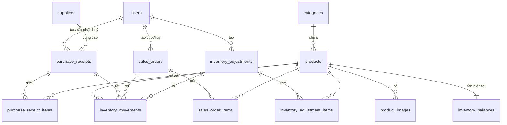
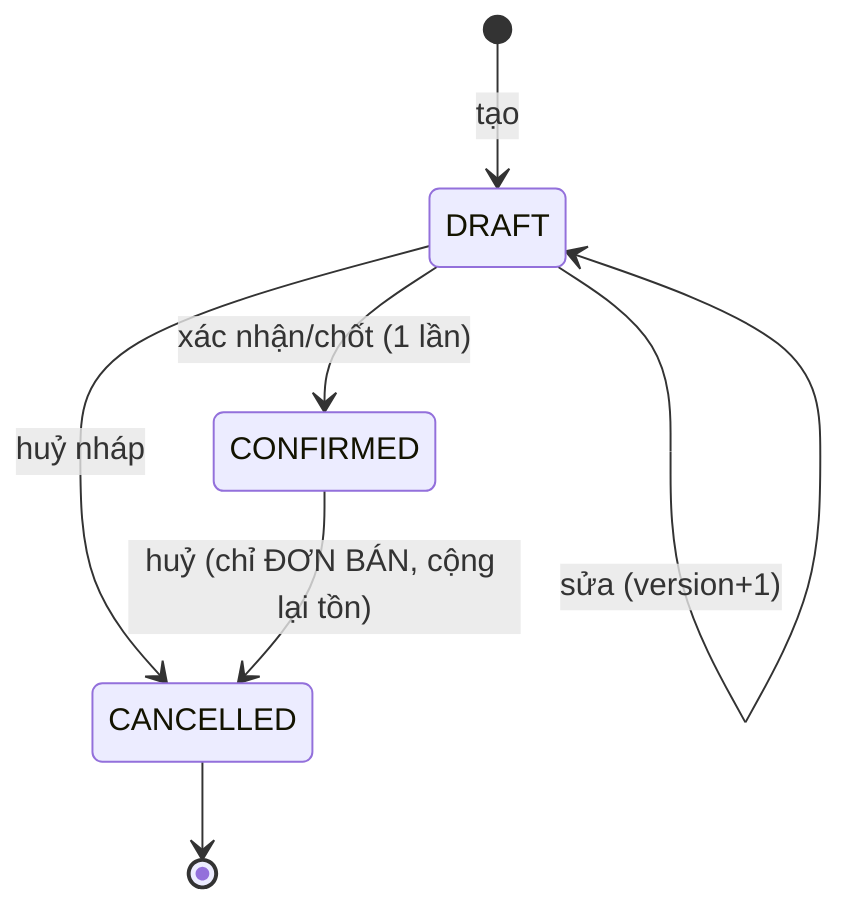

# Data Model — 001 Quản lý bán hàng & tồn kho

Quy ước chung (theo `src/packages/db`): tên bảng `snake_case` số nhiều, field TS `camelCase` (drizzle `casing: 'snake_case'`), `id uuid PK defaultRandom`, `created_at/updated_at timestamptz` qua `...timestamps`, FK tới `users.id` cho người thực hiện. Mỗi domain một file schema: `categories.ts`, `products.ts`, `suppliers.ts`, `purchases.ts`, `sales.ts`, `inventory.ts`, `document-sequences.ts`.

Kiểu số: tiền `numeric(18,2)`, giá vốn `numeric(18,4)`, số lượng `numeric(14,3)` (R2). Enum lưu `pgEnum` với giá trị lấy từ hằng số `@base/shared` — mã trung lập ngôn ngữ.

**Không tạo** `product_translations` / `category_translations` (spec Q3 = A: dữ liệu một ngôn ngữ).

## ERD

## Enum (`@base/shared/src/constants/commerce.ts`)

| Hằng số | Giá trị |
| --- | --- |
| `RECORD_STATUSES` (danh mục, nhà cung cấp) | `ACTIVE`, `INACTIVE` |
| `PRODUCT_STATUSES` | `ACTIVE`, `INACTIVE` |
| `DOCUMENT_STATUSES` (phiếu nhập, đơn bán) | `DRAFT`, `CONFIRMED`, `CANCELLED` |
| `PAYMENT_METHODS` | `CASH`, `BANK_TRANSFER`, `OTHER` |
| `PAYMENT_STATUSES` | `UNPAID`, `PAID` |
| `ADJUSTMENT_REASONS` | `DAMAGED`, `LOST`, `STOCKTAKE`, `OTHER` |
| `MOVEMENT_TYPES` | `PURCHASE_IN`, `SALE_OUT`, `SALE_CANCEL_IN`, `ADJUSTMENT_IN`, `ADJUSTMENT_OUT` |
| `MOVEMENT_REF_TYPES` | `PURCHASE_RECEIPT`, `SALES_ORDER`, `INVENTORY_ADJUSTMENT` |
| `IMAGE_STATUSES` | `PENDING`, `READY`, `DELETED` |
| `IMAGE_MIME_TYPES` | `image/jpeg`, `image/png`, `image/webp` |
| `STOCK_STATES` (tính toán, không lưu) | `IN_STOCK`, `LOW`, `OUT` |

## Bảng

### categories

| Cột | Kiểu | Ràng buộc |
| --- | --- | --- |
| id | uuid | PK |
| name | varchar(150) | NOT NULL; unique index trên `lower(name)` |
| description | text | |
| status | record_status | NOT NULL default `ACTIVE` |
| created_at, updated_at | timestamptz | |

Quy tắc: không xoá khi còn sản phẩm (`categories.inUse`); danh mục `INACTIVE` không chọn được cho sản phẩm mới.

### products

| Cột | Kiểu | Ràng buộc |
| --- | --- | --- |
| id | uuid | PK |
| sku | varchar(64) | NOT NULL; unique index `lower(sku)` |
| name | varchar(255) | NOT NULL; index trigram/`lower(name)` (xem ghi chú) |
| description | text | |
| category_id | uuid | FK categories, `ON DELETE RESTRICT`, NOT NULL |
| unit | varchar(30) | NOT NULL |
| allow_decimal_quantity | boolean | NOT NULL default false |
| purchase_price | numeric(18,2) | NOT NULL default 0, CHECK ≥ 0 (giá nhập tham khảo) |
| selling_price | numeric(18,2) | NOT NULL, CHECK ≥ 0 |
| min_stock | numeric(14,3) | NOT NULL default 0, CHECK ≥ 0 |
| status | product_status | NOT NULL default `ACTIVE` |
| has_transactions | boolean | NOT NULL default false (bật khi chứng từ đầu tiên được xác nhận/tạo; chặn xoá cứng) |
| created_by | uuid | FK users `SET NULL` |
| created_at, updated_at | timestamptz | |

Index: `(category_id)`, `(status)`. Tìm kiếm `ilike` trên `lower(name)`/`lower(sku)`; nếu SC-002 không đạt với 10k sản phẩm thì bật extension `pg_trgm` + GIN index (quyết định khi đo).

### product_images

| Cột | Kiểu | Ràng buộc |
| --- | --- | --- |
| id | uuid | PK |
| product_id | uuid | FK products `CASCADE` |
| object_key | varchar(255) | NOT NULL UNIQUE — `products/<productId>/<uuid>.<ext>` |
| mime_type | varchar(50) | NOT NULL, ∈ IMAGE_MIME_TYPES |
| size_bytes | integer | NOT NULL, CHECK > 0 |
| original_name | varchar(255) | |
| sort_order | integer | NOT NULL default 0 |
| is_primary | boolean | NOT NULL default false |
| status | image_status | NOT NULL default `PENDING` |
| upload_expires_at | timestamptz | NOT NULL khi PENDING |
| created_by | uuid | FK users `SET NULL` |
| created_at, updated_at | timestamptz | |

Ràng buộc: partial unique index `(product_id) WHERE is_primary AND status = 'READY'` (tối đa 1 ảnh chính); tối đa 10 ảnh `READY|PENDING` mỗi sản phẩm (kiểm tra trong service, khoá dòng `products FOR UPDATE`). Index `(status, upload_expires_at)` cho việc dọn.

Trạng thái: `PENDING → READY` (complete hợp lệ) · `PENDING → (xoá)` (hết hạn / file không hợp lệ) · `READY → DELETED → (xoá cứng sau khi xoá object)`.

### suppliers

| Cột | Kiểu | Ràng buộc |
| --- | --- | --- |
| id | uuid | PK |
| name | varchar(255) | NOT NULL |
| contact_person | varchar(150) | |
| phone | varchar(30) | index |
| email | varchar(255) | index `lower(email)` |
| address | text | |
| notes | text | |
| status | record_status | NOT NULL default `ACTIVE` |
| created_at, updated_at | timestamptz | |

Không xoá khi đã có phiếu nhập (`suppliers.inUse`).

### purchase_receipts

| Cột | Kiểu | Ràng buộc |
| --- | --- | --- |
| id | uuid | PK |
| code | varchar(32) | NOT NULL UNIQUE (`PN-YYYYMMDD-NNNN`) |
| supplier_id | uuid | FK suppliers `RESTRICT`, NOT NULL |
| receipt_date | date | NOT NULL |
| status | document_status | NOT NULL default `DRAFT` |
| subtotal | numeric(18,2) | NOT NULL — Σ (qty × unit_price − line_discount) |
| discount_amount | numeric(18,2) | NOT NULL default 0, CHECK ≥ 0, ≤ subtotal |
| total_amount | numeric(18,2) | NOT NULL, CHECK ≥ 0 |
| notes | text | |
| version | integer | NOT NULL default 1 (khoá lạc quan) |
| created_by / confirmed_by / cancelled_by | uuid | FK users `SET NULL` |
| confirmed_at / cancelled_at | timestamptz | |
| created_at, updated_at | timestamptz | |

Index: `(supplier_id, receipt_date)`, `(status, confirmed_at)`.
CHECK: `status <> 'CONFIRMED' OR confirmed_at IS NOT NULL`.

### purchase_receipt_items

| Cột | Kiểu | Ràng buộc |
| --- | --- | --- |
| id | uuid | PK |
| receipt_id | uuid | FK purchase_receipts `CASCADE` |
| product_id | uuid | FK products `RESTRICT` |
| line_no | integer | NOT NULL |
| quantity | numeric(14,3) | CHECK > 0 |
| unit_price | numeric(18,2) | CHECK ≥ 0 |
| discount_amount | numeric(18,2) | CHECK ≥ 0 |
| line_amount | numeric(18,2) | qty × unit_price − discount, CHECK ≥ 0 |
| unit_cost | numeric(18,4) | NULL khi nháp; ghi khi xác nhận (sau phân bổ chiết khấu phiếu) |

Index `(product_id)`. Dòng bị xoá/ghi lại toàn bộ khi sửa nháp.

### sales_orders

| Cột | Kiểu | Ràng buộc |
| --- | --- | --- |
| id | uuid | PK |
| code | varchar(32) | NOT NULL UNIQUE (`DH-YYYYMMDD-NNNN`) |
| client_request_id | uuid | UNIQUE NULL (idempotency) |
| order_date | date | NOT NULL |
| customer_name | varchar(150) | |
| customer_phone | varchar(30) | index |
| status | document_status | NOT NULL default `DRAFT` |
| payment_method | payment_method | NOT NULL default `CASH` |
| payment_status | payment_status | NOT NULL default `UNPAID` |
| paid_at | timestamptz | |
| subtotal | numeric(18,2) | Σ line_amount |
| discount_amount | numeric(18,2) | CHECK ≥ 0, ≤ subtotal |
| total_amount | numeric(18,2) | CHECK ≥ 0 |
| total_cost | numeric(18,2) | NULL khi nháp; Σ cost_amount khi chốt |
| notes | text | |
| version | integer | NOT NULL default 1 |
| created_by / confirmed_by / cancelled_by / paid_by | uuid | FK users `SET NULL` |
| confirmed_at / cancelled_at | timestamptz | |
| created_at, updated_at | timestamptz | |

Index: `(status, confirmed_at)`, `(created_by, created_at)`, `(payment_status)`.
CHECK: `payment_status = 'UNPAID' OR paid_at IS NOT NULL`.

### sales_order_items

| Cột | Kiểu | Ràng buộc |
| --- | --- | --- |
| id | uuid | PK |
| order_id | uuid | FK sales_orders `CASCADE` |
| product_id | uuid | FK products `RESTRICT` |
| line_no | integer | |
| sku_snapshot, name_snapshot, unit_snapshot | varchar | NOT NULL — snapshot lúc tạo/chốt |
| quantity | numeric(14,3) | CHECK > 0 |
| list_price | numeric(18,2) | giá niêm yết lúc thêm dòng |
| unit_price | numeric(18,2) | giá bán thực tế, CHECK ≥ 0 |
| discount_amount | numeric(18,2) | CHECK ≥ 0 |
| line_amount | numeric(18,2) | qty × unit_price − discount |
| allocated_order_discount | numeric(18,2) | ghi khi chốt |
| net_amount | numeric(18,2) | line_amount − allocated (doanh thu thuần dòng) |
| unit_cost | numeric(18,4) | NULL khi nháp; avg_cost lúc chốt |
| cost_amount | numeric(18,2) | qty × unit_cost (làm tròn) |

Index `(product_id)`, `(order_id)`.

### inventory_balances

| Cột | Kiểu | Ràng buộc |
| --- | --- | --- |
| product_id | uuid | PK, FK products `CASCADE` |
| quantity | numeric(14,3) | NOT NULL default 0, **CHECK ≥ 0** |
| avg_cost | numeric(18,4) | NOT NULL default 0, CHECK ≥ 0 |
| last_movement_at | timestamptz | |
| updated_at | timestamptz | |

Tạo cùng lúc với sản phẩm (cùng transaction). Chỉ `InventoryService` được ghi.

### inventory_movements (sổ cái, chỉ thêm)

| Cột | Kiểu | Ràng buộc |
| --- | --- | --- |
| id | uuid | PK |
| product_id | uuid | FK products `RESTRICT` |
| type | movement_type | NOT NULL |
| quantity_change | numeric(14,3) | NOT NULL, ≠ 0 (dương = vào, âm = ra) |
| quantity_before / quantity_after | numeric(14,3) | NOT NULL, `after = before + change`, `after ≥ 0` |
| unit_cost | numeric(18,4) | giá vốn áp cho biến động |
| avg_cost_after | numeric(18,4) | |
| ref_type | movement_ref_type | NOT NULL |
| ref_id | uuid | NOT NULL |
| ref_code | varchar(32) | NOT NULL (hiển thị nhanh) |
| ref_item_id | uuid | |
| reason | adjustment_reason | NULL trừ khi điều chỉnh |
| note | text | |
| created_by | uuid | FK users `SET NULL` |
| created_at | timestamptz | NOT NULL default now() |

Index: `(product_id, created_at)`, `(ref_type, ref_id)`, `(type, created_at)`.
Bất biến: Σ `quantity_change` theo sản phẩm = `inventory_balances.quantity` (test đối soát SC-004). Không API sửa/xoá.

### inventory_adjustments / inventory_adjustment_items

`inventory_adjustments`: `id`, `code` UNIQUE (`DC-…`), `client_request_id` UNIQUE NULL, `reason` NOT NULL, `note` (NOT NULL khi `OTHER` — CHECK), `created_by`, `created_at`.

`inventory_adjustment_items`: `id`, `adjustment_id` FK CASCADE, `product_id` FK RESTRICT, `quantity_before`, `quantity_change` (≠ 0), `quantity_after` (≥ 0), `counted_quantity` (NULL trừ STOCKTAKE), `unit_cost`.

Điều chỉnh được tạo và áp dụng ngay (không có nháp).

### document_sequences

`prefix varchar(8)`, `seq_date date`, `last_value integer` — PK `(prefix, seq_date)` (R14).

## Chuyển trạng thái

- Phiếu nhập `CONFIRMED` là trạng thái cuối (spec Q1).
- Thanh toán đơn bán: `UNPAID → PAID` (một chiều); chỉ ghi nhận khi đơn `CONFIRMED` (hoặc khi chốt). Đơn `CANCELLED` giữ nguyên `payment_status` để đối soát; hoàn tiền xử lý ngoài hệ thống (spec Q2).

## Quy tắc tính toán (tóm tắt, chi tiết ở research R5)

- `line_amount = round2(quantity × unit_price) − discount_amount` (≥ 0).
- `subtotal = Σ line_amount`; `total = subtotal − discount_amount` (≥ 0).
- Phân bổ chiết khấu chứng từ theo tỷ lệ `line_amount`: mỗi dòng làm tròn xuống, phần dư dồn vào dòng cuối có `line_amount` > 0 (tổng luôn khớp, không dòng nào âm).
- Giá trị tồn = Σ `quantity × avg_cost`.
- Lợi nhuận gộp = Σ `net_amount` − Σ `cost_amount` của dòng thuộc đơn `CONFIRMED` (theo `confirmed_at`).
- Trạng thái tồn: `OUT` nếu quantity = 0; `LOW` nếu 0 < quantity ≤ min_stock; ngược lại `IN_STOCK`.
