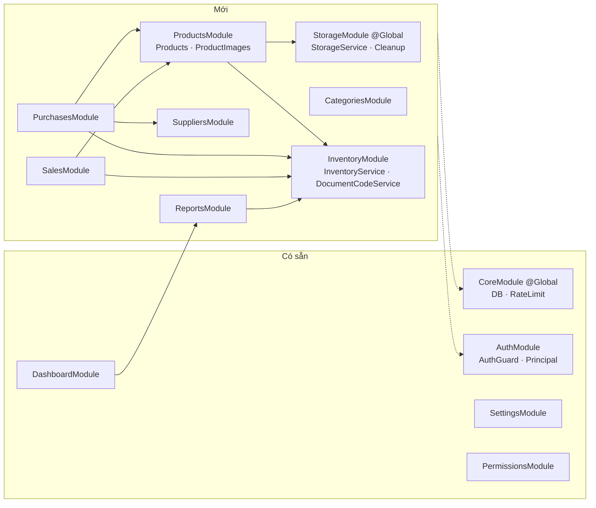
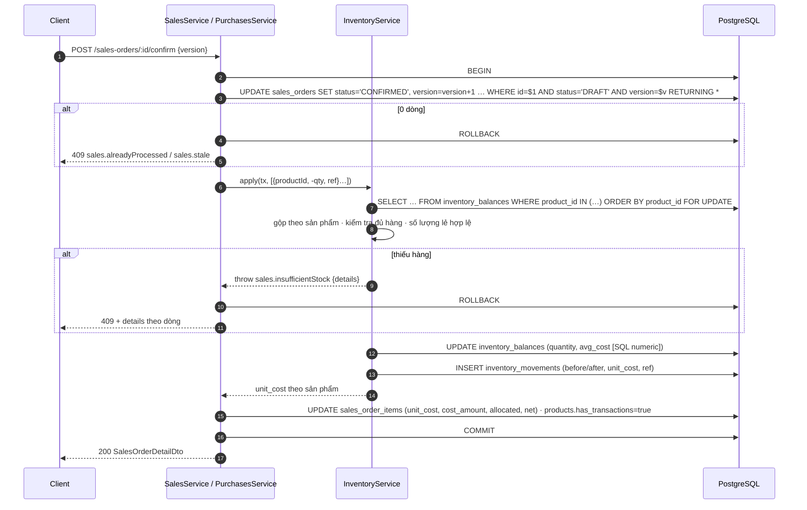

# Implementation Plan: Quản lý bán hàng & tồn kho (MVP)

**Branch**: `001-sales-inventory-mvp` | **Date**: 2026-11-19 | **Spec**: [spec.md](spec.md)

**Input**: Feature specification from `/specs/001-sales-inventory-mvp/spec.md`

**Trạng thái**: Chờ duyệt kiến trúc — **chưa sửa mã nguồn**.

## Summary

Bổ sung nghiệp vụ bán hàng & tồn kho một kho vào monorepo BaseWebSystem hiện có: danh mục, sản phẩm (ảnh trên MinIO qua presigned POST/GET), nhà cung cấp, phiếu nhập, đơn bán, sổ cái tồn kho với giá vốn bình quân gia quyền di động, điều chỉnh tồn, dashboard và báo cáo lợi nhuận. Backend thêm 8 module NestJS dùng lại auth/RBAC/response/i18n sẵn có; mọi thay đổi tồn đi qua một `InventoryService` duy nhất, khoá dòng theo thứ tự cố định + cập nhật trạng thái có điều kiện để chống xác nhận trùng và tồn âm. App admin nhận các màn hình quản lý; app user giữ vai trò tự phục vụ và thêm khu vực Bán hàng chỉ hiện với tài khoản có quyền. Chi tiết quyết định: [research.md](research.md).

## Technical Context

**Language/Version**: TypeScript ~6.0 (strict), Node.js ≥ 22

**Primary Dependencies**: NestJS 11 (Express 5), Drizzle ORM 0.45 + drizzle-kit, zod 4, React 19 + Vite 8 + antd 6, react-router 7, @tanstack/react-query 5, i18next/react-i18next, dayjs, recharts. **Mới**: `minio` (S3 client), `@nestjs/swagger` (OpenAPI) — xem Complexity Tracking.

**Storage**: PostgreSQL (bảng mới, migration drizzle-kit); MinIO bucket private `products` cho ảnh.

**Testing**: Vitest + supertest — e2e NestJS thật trên DB `<tên>_test`; unit test `@base/server-kit`; `FakeStorageService` thay MinIO; bộ tích hợp MinIO thật khi có `TEST_MINIO_URL`.

**Target Platform**: Linux server (systemd + nginx sau Cloudflare), trình duyệt desktop & mobile.

**Project Type**: Web application — monorepo (1 API + 2 SPA + packages dùng chung).

**Performance Goals**: Tìm sản phẩm < 1 s với 10.000 sản phẩm (SC-002); dashboard/báo cáo 1 năm (~100.000 dòng đơn) < 3 s (SC-007); chốt đơn 5 dòng phản hồi < 500 ms p95.

**Constraints**: Tồn kho không âm dưới đồng thời (SC-003); sổ cái khớp tồn 100% (SC-004); tiền/số lượng không dùng số thực JS; credential MinIO chỉ ở backend; không đổi hành vi hiện có (SC-010).

**Scale/Scope**: SMB một cửa hàng: ≤ 10.000 sản phẩm, ≤ 50 người dùng đồng thời, ~300 đơn/ngày; 8 module backend, ~45 endpoint, ~15 màn hình admin, 3 màn hình bán hàng.

Không còn mục NEEDS CLARIFICATION (đã giải quyết trong research.md).

## Constitution Check

*GATE: Must pass before Phase 0 research. Re-check after Phase 1 design.*

| Nguyên tắc | Đánh giá | Ghi chú |
| --- | --- | --- |
| I. Bảo toàn kiến trúc | ✅ | Không package/app mới; module đặt trong `src/backends/api/src`, schema `@base/db`, DTO `@base/shared`, SDK `@base/api-client`, UI dùng chung `@base/ui`. 2 dependency mới có lý do (Complexity Tracking). |
| II. Backend chỉ API | ✅ | Controller mỏng, validate zod, response chuẩn, transaction cho xác nhận/huỷ/điều chỉnh, OpenAPI qua `@nestjs/swagger` sinh từ chính schema zod (đóng TODO(OPENAPI_TOOLING)). |
| III. Auth & RBAC có sẵn | ✅ | Không route public; 36 quyền mới trong `PERMISSION_DEFINITIONS`; quyền năng lực (`products.viewCost`, `sales.viewAll`…) kiểm tra ở backend; vai trò Manager/Staff seed không ghi đè cấu hình. |
| IV. Hai frontend tách biệt | ✅ | Admin = quản lý; user = bán hàng có guard quyền; component chung ở `@base/ui/src/commerce`; gọi API qua SDK + react-query; trạng thái loading/lỗi/rỗng. |
| V. Đa ngôn ngữ | ✅ | Namespace theo module ở 2 app + backend; enum là mã trung lập; lỗi trả `key` + `params` + `details` (đóng TODO(ERROR_PARAMS)); tiền VND qua `Intl.NumberFormat`. |
| VI. MinIO | ✅ | Bucket private, presigned POST (ràng buộc size/type) + presigned GET, metadata ở PG, credential ở `.env` backend; avatar không đổi (đóng TODO(MINIO_SETUP) ở bước triển khai). |
| VII. Toàn vẹn bán hàng & tồn | ✅ | Khoá dòng `FOR UPDATE` theo thứ tự + `CHECK quantity ≥ 0`; cập nhật trạng thái có điều kiện; sổ cái chỉ thêm; `numeric`; snapshot giá bán/giá vốn/tên trên dòng đơn. |
| VIII. Chất lượng & kiểm thử | ✅ | Unit test tính tiền/phân bổ/giá vốn; e2e tồn kho gồm ca đồng thời; không đổi hành vi cũ ngoài phần cộng thêm `params` trong body lỗi (tương thích ngược, được nêu rõ). |

**Kết quả trước Phase 0**: PASS. **Sau Phase 1**: PASS — thiết kế không phát sinh vi phạm mới.

## Kiến trúc đề xuất

### Sơ đồ phụ thuộc module (backend)



- `InventoryModule` export `InventoryService` (ghi tồn + sổ cái, duy nhất) và `DocumentCodeService` (sinh mã chứng từ). Không phụ thuộc ngược vào Purchases/Sales → không vòng.
- `ProductsModule` dùng `InventoryService.initBalance(tx, productId)` khi tạo sản phẩm và để đọc tồn.
- `ReportsModule` export `ReportsQueryService` cho `DashboardModule` (sales-summary).
- Quy tắc tính tiền/phân bổ: hàm thuần ở `@base/server-kit/src/decimal.ts` + `src/backends/api/src/sales/pricing.ts` (dùng chung cho purchases) để unit test độc lập.

### Luồng giao dịch tồn kho



Áp dụng tương tự cho: xác nhận phiếu nhập (biến động dương, tính lại `avg_cost`), huỷ đơn bán (dương, giá vốn theo dòng), điều chỉnh tồn (±, `avg_cost` giữ nguyên). `POST /sales-orders` với `confirm: true` chạy tạo + chốt trong **một** transaction. Công thức giá vốn: research R5.

### Thiết kế dữ liệu

Xem [data-model.md](data-model.md) (ERD, bảng, ràng buộc, index, chuyển trạng thái). Bảng mới: `categories`, `products`, `product_images`, `suppliers`, `purchase_receipts`, `purchase_receipt_items`, `sales_orders`, `sales_order_items`, `inventory_balances`, `inventory_movements`, `inventory_adjustments`, `inventory_adjustment_items`, `document_sequences`. Không có bảng tương đương sẵn trong repo; không tạo bảng dịch (spec Q3).

### API

Xem [contracts/rest-api.md](contracts/rest-api.md) (method, URL, quyền, request/response DTO, validate, lỗi), [contracts/permissions.md](contracts/permissions.md), [contracts/storage-upload.md](contracts/storage-upload.md). Thay đổi chung: thêm `params` vào body lỗi (`@base/server-kit/src/response.ts`, type `ApiError` ở `@base/shared`); Swagger tại `/api/docs` (`app.setup.ts`, bật theo `API_DOCS_ENABLED`).

### Frontend

**App admin** (`src/frontends/admin`) — feature mới dưới `src/features/`, route bọc `RequirePermission`, menu `AdminLayout.tsx` thêm 2 nhóm:

| Nhóm menu | Trang (route) | Quyền route |
| --- | --- | --- |
| Tổng quan | Dashboard (`/`) — thêm khối bán hàng khi có `dashboard.salesSummary`, giữ biểu đồ người dùng | — |
| Hàng hoá | Sản phẩm (`/products`, drawer chi tiết + `ProductImagesManager`), Danh mục (`/categories`) | `products.list`, `categories.list` |
| Mua hàng | Nhà cung cấp (`/suppliers`, chi tiết có lịch sử nhập), Phiếu nhập (`/purchases`, `/purchases/new`, `/purchases/:id`) | `suppliers.list`, `purchases.list` |
| Bán hàng | Đơn bán (`/sales-orders`, `/sales-orders/:id`: xem, thanh toán, huỷ) | `sales.list` |
| Kho | Tồn kho (`/inventory`), Sổ biến động (`/inventory/movements`), Điều chỉnh (`/inventory/adjustments`, `/inventory/adjustments/new`) | `inventory.*` |
| Báo cáo | `/reports` (tabs: Doanh thu ngày/tháng, Theo sản phẩm/bán chạy, Lợi nhuận, Nhập hàng, Tồn kho, Biến động) | `reports.*` |
| Quản trị (có sẵn) | Người dùng, Vai trò, Quyền, Cài đặt | giữ nguyên |

**App user** (`src/frontends/user`) — nhóm menu "Bán hàng" ẩn nếu `!can('sales.create')`:

| Trang | Mô tả |
| --- | --- |
| `/pos` | Ô tìm tên/SKU (debounce 300 ms, `GET /products?status=ACTIVE`), lưới/danh sách kết quả có ảnh chính, giá, tồn; giỏ hàng (state cục bộ + `sessionStorage` khôi phục khi F5), chỉnh SL/giá (nếu `sales.overridePrice`)/chiết khấu, khách, phương thức, "Đã thanh toán"; nút **Chốt đơn** (`POST` `confirm: true`, `clientRequestId` sinh 1 lần cho mỗi giỏ) và **Lưu nháp** |
| `/sales` | Lịch sử đơn (mặc định hôm nay, đơn của mình) |
| `/sales/:id` | Chi tiết đơn; mở lại đơn nháp vào `/pos?draft=:id` |

Trang chủ hiện tại giữ nguyên; người có quyền bán hàng được chuyển thẳng tới `/pos` sau đăng nhập (tuỳ chọn, mặc định bật).

**Dùng chung** (`src/packages/ui/src/commerce/`): `Money` / `formatMoney`, `formatQuantity`, `DocumentStatusTag`, `PaymentStatusTag`, `StockStateTag`, `SalesOrderTable`, `SalesOrderDetail`, `ProductThumb`, `useProductSearch`. Mọi phép tính tổng tiền trên giao diện chỉ là **xem trước**; số liệu cuối cùng lấy từ response backend (không lặp nghiệp vụ). Input tiền dùng `InputNumber stringMode`.

Lỗi: `useNotifyError` hiện thông điệp; riêng `sales.insufficientStock` / `inventory.negativeStock` đọc `details` để đánh dấu đúng dòng; `*.stale` → hỏi tải lại dữ liệu. Trạng thái rỗng dùng `Empty` với hành động gợi ý (vd. "Tạo sản phẩm đầu tiên").

### Chiến lược i18n

- **Thư viện**: giữ i18next (`createI18n`), dayjs, antd locale — không thêm thư viện.
- **Quy ước key**: `<namespace>.<nhóm>.<mục>`; namespace = module: admin `categories`, `products`, `suppliers`, `purchases`, `salesOrders`, `inventory`, `reports`; user `pos`, `sales`; dùng chung (`@base/ui`) `commerce` gồm `commerce.status.DRAFT|CONFIRMED|CANCELLED`, `commerce.paymentMethod.CASH|…`, `commerce.paymentStatus.*`, `commerce.adjustmentReason.*`, `commerce.movementType.*`, `commerce.stockState.*`. Nhãn enum luôn tra theo **mã** (`t(\`commerce:status.${s}\`)`), không lưu chuỗi dịch.
- **Backend**: `src/backends/api/src/i18n/{vi,en}.ts` thêm nhóm `categories`, `products`, `productImages`, `suppliers`, `purchases`, `sales`, `inventory`, `reports`, `documents`, `storage` (thông báo lỗi có tham số `{{sku}}`, `{{available}}`…); permission label ở locale admin.
- **Định dạng**: `formatMoney(value, locale)` = `Intl.NumberFormat(locale === 'vi' ? 'vi-VN' : 'en-US', { style: 'currency', currency: 'VND', maximumFractionDigits: 0 })`; số lượng `maximumFractionDigits: 3`; ngày `formatDateTime` hiện có (dayjs theo locale). Tiền tệ luôn VND.
- **Lưu ngôn ngữ**: cơ chế có sẵn (`users.lang` + localStorage `base.<app>.lang`).
- **Kiểm tra**: `en` có kiểu bắt buộc giống `vi` ở backend; thêm test (vitest) so khớp tập key `vi`/`en` cho locale frontend mới (SC-006).

### Chiến lược kiểm thử

| Loại | Phạm vi | Vị trí |
| --- | --- | --- |
| Unit | `decimal.ts` (làm tròn, chia, phân bổ dư), `pricing.ts` (line/subtotal/total, phân bổ chiết khấu), công thức giá vốn, sinh mã, magic bytes ảnh | `src/packages/server-kit/test/decimal.test.ts`, `src/backends/api/test/commerce.unit.test.ts` |
| e2e CRUD + quyền | categories, products, suppliers: tạo/sửa/ngừng/xoá, trùng SKU, 401/403/422/409; ma trận Staff/Manager/User mặc định (SC-008, SC-010) | `test/catalog.test.ts`, `test/commerce.permissions.test.ts` |
| e2e nhập hàng | nháp không đổi tồn, xác nhận cộng tồn + giá vốn bình quân, xác nhận trùng (tuần tự + `Promise.all`), không huỷ được phiếu đã xác nhận, version lệch | `test/purchases.test.ts` |
| e2e bán hàng | chốt trừ tồn, thiếu hàng + details, chốt trùng, idempotent `clientRequestId`, sửa giá cần quyền, thanh toán một chiều, huỷ cộng lại tồn, phạm vi `sales.viewAll`, ẩn giá vốn | `test/sales.test.ts` |
| Đồng thời | 50 request chốt đồng thời trên tồn 10 → đúng 10 thành công, tồn 0 (SC-003); nhập + bán xen kẽ; khoá theo thứ tự (2 đơn đảo thứ tự sản phẩm không deadlock) | `test/inventory.concurrency.test.ts` |
| Sổ cái | sau mọi kịch bản: Σ movements = balance cho mọi sản phẩm (SC-004); điều chỉnh âm bị chặn; kiểm kê tính chênh lệch | `test/inventory.test.ts` |
| Báo cáo | bộ dữ liệu cố định → doanh thu, giá vốn, lợi nhuận khớp tính tay (SC-005); loại đơn huỷ; ranh giới ngày theo giờ VN | `test/reports.test.ts` |
| Ảnh | FakeStorage: giới hạn 10 ảnh, sai mime/size, complete khi chưa upload, magic bytes sai, ảnh chính khi xoá, thay ảnh, cleanup PENDING hết hạn/DELETED; MinIO thật khi có `TEST_MINIO_URL` | `test/product-images.test.ts`, `test/storage.minio.test.ts` |
| i18n | lỗi trả đúng ngôn ngữ theo `x-lang`, có `params`; khớp key vi/en | trong các file trên + `test/i18n.keys.test.ts` |

Helper mới: `FakeStorageService` (override trong `createTestApp`), fixture `createProduct/createSupplier/stockIn(productId, qty, cost)`, `signedInClient(t, { role: 'Manager' | 'Staff' })` (mở rộng `createUser` nhận tên role).

### Triển khai

- **Không Docker** (repo không dùng). MinIO: binary + systemd, bucket private `products`, user MinIO riêng chỉ quyền trên bucket, domain riêng `files.<domain>` sau Cloudflare (nginx giữ `Host`), CORS cho 2 app; nginx `client_max_body_size` không cần đổi vì ảnh không đi qua API.
- **Biến môi trường mới** (`src/backends/api/.env.example` + README bảng biến): `MINIO_ENDPOINT`, `MINIO_PUBLIC_URL`, `MINIO_ACCESS_KEY`, `MINIO_SECRET_KEY`, `MINIO_BUCKET`, `MINIO_REGION`, `PRODUCT_IMAGE_MAX_BYTES`, `API_DOCS_ENABLED`. Thiếu cấu hình MinIO: API vẫn khởi động, chức năng ảnh trả `503 storage.unavailable` và log cảnh báo (không chặn bán hàng).
- **Thứ tự cập nhật**: `pnpm install` → `pnpm db:migrate` → `pnpm db:seed` (thêm quyền, tạo Manager/Staff) → build → restart API. Migration chỉ thêm bảng/enum, không sửa bảng cũ → rollback = triển khai lại bản cũ (bảng mới không ảnh hưởng).
- **Swagger production**: mặc định tắt; bật thì nên đặt sau Cloudflare Access.
- **Tài liệu cập nhật** (khi được duyệt): README (Tính năng, Biến môi trường, Triển khai — mục MinIO), `docs/architecture.md` (module, bản đồ API, tồn kho, lưu trữ), `docs/permissions.md` (quyền mới, loại CLIENT năng lực, vai trò Manager/Staff), `docs/TEST-CASES.md`, `CLAUDE.md` + skill (`feature-module`, `api-testing` thêm FakeStorage).

## Project Structure

### Documentation (this feature)

```text
specs/001-sales-inventory-mvp/
├── spec.md
├── plan.md              # file này
├── research.md          # quyết định kỹ thuật R0–R17
├── data-model.md        # ERD, bảng, ràng buộc, trạng thái
├── quickstart.md        # kiểm chứng end-to-end
├── contracts/
│   ├── rest-api.md      # endpoint, DTO, quyền, lỗi
│   ├── permissions.md   # quyền mới + vai trò mặc định
│   └── storage-upload.md# luồng MinIO
├── checklists/requirements.md
└── tasks.md             # /speckit-tasks (chưa tạo)
```

### Source Code (repository root)

```text
src/
├── backends/api/
│   ├── src/
│   │   ├── storage/            # MỚI: storage.module, storage.service, storage-cleanup.service
│   │   ├── categories/         # MỚI
│   │   ├── products/           # MỚI: products.*, product-images.service
│   │   ├── suppliers/          # MỚI
│   │   ├── purchases/          # MỚI
│   │   ├── sales/              # MỚI: sales.*, pricing.ts
│   │   ├── inventory/          # MỚI: inventory.*, document-code.service, adjustments
│   │   ├── reports/            # MỚI: reports.*, reports-query.service
│   │   ├── dashboard/          # SỬA: + sales-summary
│   │   ├── decorators/         # SỬA: + api-docs.ts (ApiZod*)
│   │   ├── config/env.ts       # SỬA: + biến MinIO, API_DOCS_ENABLED
│   │   ├── app.module.ts / app.setup.ts  # SỬA: đăng ký module, Swagger
│   │   └── i18n/{vi,en}.ts     # SỬA: key lỗi mới
│   └── test/                   # MỚI: các file test ở bảng trên; helpers: fake-storage.ts, commerce fixtures
├── frontends/
│   ├── admin/src/
│   │   ├── features/{categories,products,suppliers,purchases,sales-orders,inventory,reports}/  # MỚI
│   │   ├── pages/DashboardPage.tsx   # SỬA
│   │   ├── app/{router.tsx,AdminLayout.tsx}  # SỬA
│   │   └── locales/{vi,en}.ts        # SỬA: namespace mới + permissions.items
│   └── user/src/
│       ├── features/{pos,sales}/      # MỚI
│       ├── app/{router.tsx,UserLayout.tsx}  # SỬA
│       └── locales/{vi,en}.ts         # SỬA
└── packages/
    ├── db/src/schema/{categories,products,suppliers,purchases,sales,inventory,document-sequences}.ts  # MỚI
    ├── db/seeds/index.ts                 # SỬA: role Manager/Staff
    ├── shared/src/constants/{commerce.ts,permissions.ts}  # MỚI/SỬA
    ├── shared/src/schemas/{category,product,supplier,purchase,sales,inventory,report}.ts  # MỚI
    ├── server-kit/src/{decimal.ts,response.ts}  # MỚI/SỬA (params)
    ├── api-client/src/endpoints/commerce.ts  # MỚI (+ đăng ký createApi)
    └── ui/src/commerce/ + i18n/locales (namespace commerce)  # MỚI
```

**Structure Decision**: Giữ nguyên monorepo hiện có; mỗi domain mới là một module trong `@base/api` và một feature trong app tương ứng, theo đúng mẫu `roles`/`users` hiện tại (skill `feature-module`).

### Thứ tự triển khai đề xuất (đầu vào cho /speckit-tasks)

1. Nền tảng: `decimal.ts`, `params` trong lỗi, Swagger helper, hằng số/enum, schema DB + migration, quyền + seed vai trò, `InventoryService` + `DocumentCodeService`.
2. US1 Danh mục & sản phẩm (P1) → US3 Nhà cung cấp & nhập hàng (P1) → US6 Tồn kho & điều chỉnh (P1) → US4 Bán hàng tại quầy (P1) → US8 phân quyền (kiểm thử ma trận).
3. US2 Ảnh MinIO (P2) → US5 Lịch sử đơn (P2) → US7 Dashboard & báo cáo (P2) → US9 hoàn thiện i18n.
4. Tài liệu & quickstart.

## Complexity Tracking

> **Fill ONLY if Constitution Check has violations that must be justified**

Không có vi phạm. Ghi nhận các bổ sung cần duyệt theo constitution I (dependency mới):

| Bổ sung | Why Needed | Simpler Alternative Rejected Because |
|-----------|------------|-------------------------------------|
| Dependency `minio` | Presigned POST có ràng buộc size/type, presigned GET, thao tác object (constitution VI) | Tự ký AWS SigV4 — dễ sai bảo mật; `@aws-sdk/*` cần 3 package và nặng hơn |
| Dependency `@nestjs/swagger` | Constitution II bắt buộc OpenAPI | Viết OpenAPI tay — lệch code; `nestjs-zod` thêm lớp DTO trùng cơ chế validate hiện có |
| Thêm `params` vào body lỗi | FR-038 / constitution V | Chỉ dùng `message` — không gắn lỗi vào từng dòng; thay đổi là cộng thêm, client cũ không ảnh hưởng |
