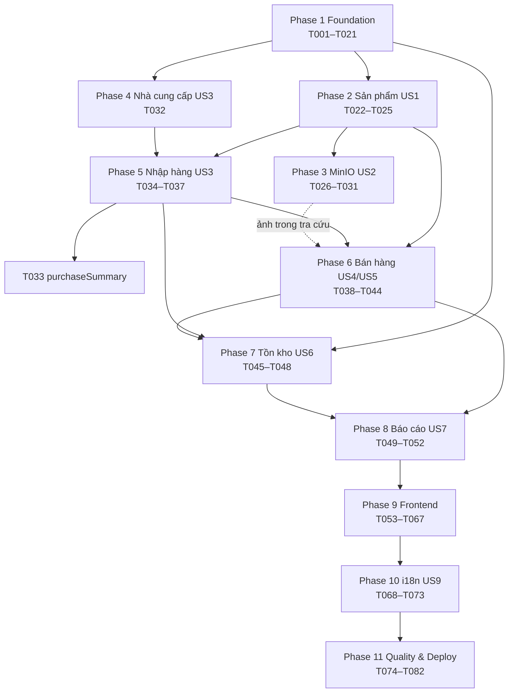

---

description: "Backlog triển khai 001 — Quản lý bán hàng & tồn kho (MVP)"
---

# Tasks: Quản lý bán hàng & tồn kho (MVP)

**Input**: `specs/001-sales-inventory-mvp/` — [spec.md](spec.md), [plan.md](plan.md), [research.md](research.md), [data-model.md](data-model.md), [contracts/](contracts/), [quickstart.md](quickstart.md); `.specify/memory/constitution.md` v1.0.0.

**Tests**: Có — người dùng yêu cầu unit, integration (e2e), đồng thời, phân quyền, i18n. Test viết cùng batch với code nó kiểm chứng (skill `api-testing`).

**Organization**: 11 phase theo yêu cầu người dùng; backend nghiệp vụ (Phase 1–8) trước, tích hợp frontend (Phase 9) sau. Nhãn `[USn]` ánh xạ user story trong spec để truy vết.

## Format

```text
- [ ] T### [P?] [USn?] Mô tả — `đường dẫn thật`
  - Deps: task phụ thuộc
  - Result: kết quả mong đợi
  - AC: tiêu chí nghiệm thu
  - Test: yêu cầu kiểm thử
```

- **[P]**: chạy song song được (file khác nhau, không phụ thuộc task chưa xong).
- **[USn]**: US1 Danh mục & sản phẩm · US2 Ảnh · US3 Nhà cung cấp & nhập hàng · US4 Bán tại quầy · US5 Lịch sử đơn · US6 Tồn kho & điều chỉnh · US7 Dashboard & báo cáo · US8 Phân quyền · US9 Song ngữ.
- Mọi task code: kết thúc batch bằng `pnpm lint` + `pnpm typecheck` sạch (skill `base-skill`); batch có backend chạy thêm `pnpm --filter @base/api test`.
- Ràng buộc trường dữ liệu tra theo `data-model.md` (trích `Bảng.cột`); task chỉ ghi rõ khi **thu hẹp/bổ sung** quy tắc.
- Không refactor code không liên quan.

---

## Phase 1: Foundation (chặn mọi phase sau)

**Mục tiêu**: hạ tầng dùng chung — kiểu số, lỗi có tham số, OpenAPI, enum, schema DB + migration, quyền + vai trò, lõi tồn kho.

### Batch 1.1 — Xác minh điểm tích hợp & tiện ích nền

- [x] T001 Xác minh lại điểm tích hợp ghi trong `research.md` §0 (module, `CoreModule` @Global, `createApi`, `createI18n`, `errorBody`, `createTestApp`) và ghi lệch (nếu có) vào cuối `specs/001-sales-inventory-mvp/research.md`
  - Deps: —
  - Result: Danh sách điểm tích hợp đã xác nhận với đường dẫn thật.
  - AC: Mọi đường dẫn nêu trong plan.md § Project Structure tồn tại (hoặc được đánh dấu "tạo mới"); không sửa mã nguồn.
  - Test: Không (tài liệu).
- [x] T002 [P] Tạo helper thập phân BigInt scale cố định (`parse`, `toString`, `add`, `sub`, `mul`, `div` half-up, `cmp`, `isInteger`, `allocate` phân bổ theo tỷ lệ, phần dư vào dòng cuối có trọng số > 0) trong `src/packages/server-kit/src/decimal.ts`, export ở `src/packages/server-kit/src/index.ts`
  - Deps: —
  - Result: Hàm thuần, không dependency mới (research R3).
  - AC: Không dùng `number` cho phép tính tiền; chuỗi đầu vào sai định dạng ném lỗi rõ ràng.
  - Test: Unit `src/packages/server-kit/test/decimal.test.ts`: làm tròn half-up 2/4 chữ số, chia hết/không hết, `allocate` tổng đúng bằng tổng gốc, số âm, số rất lớn (18 chữ số).
- [x] T003 [P] Thêm `params` vào body lỗi (`error.params` khi `AppError.params` có giá trị) trong `src/packages/server-kit/src/response.ts`; cập nhật kiểu lỗi API trong `src/packages/shared/src/api/response.ts`
  - Deps: —
  - Result: `{ code, key, message, params?, details? }` (research R8).
  - AC: Response lỗi cũ không đổi khi không có params; FE hiện có vẫn typecheck.
  - Test: Bổ sung case vào `src/packages/server-kit/test/security.test.ts` hoặc file mới `src/packages/server-kit/test/response.test.ts`: có/không params.
- [x] T004 [P] Thêm biến môi trường `MINIO_ENDPOINT`, `MINIO_PUBLIC_URL`, `MINIO_ACCESS_KEY`, `MINIO_SECRET_KEY`, `MINIO_BUCKET` (mặc định `products`), `MINIO_REGION` (mặc định `us-east-1`), `PRODUCT_IMAGE_MAX_BYTES` (mặc định 5242880), `API_DOCS_ENABLED` (mặc định true ngoài production) vào `src/backends/api/src/config/env.ts` và `src/backends/api/.env.example` (có chú thích tiếng Việt)
  - Deps: —
  - Result: Biến MinIO tuỳ chọn; thiếu → chức năng ảnh tắt, API vẫn khởi động (plan § Triển khai).
  - AC: `getEnv()` không lỗi khi thiếu MinIO; secret không được log.
  - Test: Typecheck; e2e hiện có vẫn pass.

### Batch 1.2 — OpenAPI

- [ ] T005 Thêm dependency `@nestjs/swagger` vào `src/backends/api/package.json`; tạo `ApiZodBody`, `ApiZodQuery`, `ApiZodResponse` (dùng `z.toJSONSchema`) trong `src/backends/api/src/decorators/api-docs.ts`
  - Deps: T004
  - Result: Decorator sinh tài liệu từ cùng schema zod dùng để validate (research R7).
  - AC: Không thêm class-validator / nestjs-zod; decorator không ảnh hưởng validate.
  - Test: Typecheck + build `pnpm --filter @base/api build`.
- [ ] T006 Đăng ký Swagger tại `/api/docs` và `/api/docs-json` khi `API_DOCS_ENABLED` trong `src/backends/api/src/app.setup.ts`
  - Deps: T005
  - Result: Swagger UI hiện các route hiện có (tối thiểu tên route).
  - AC: Production mặc định tắt; route docs không đi qua `AuthGuard` của prefix `/api/v1`.
  - Test: e2e mới `src/backends/api/test/api-docs.test.ts`: `GET /api/docs-json` trả 200 khi bật, 404 khi tắt.

### Batch 1.3 — Hằng số, enum, schema zod

- [ ] T007 [P] Tạo enum dùng chung (`RECORD_STATUSES`, `PRODUCT_STATUSES`, `DOCUMENT_STATUSES`, `PAYMENT_METHODS`, `PAYMENT_STATUSES`, `ADJUSTMENT_REASONS`, `MOVEMENT_TYPES`, `MOVEMENT_REF_TYPES`, `IMAGE_STATUSES`, `IMAGE_MIME_TYPES`, `STOCK_STATES`) + schema zod tiền/số lượng dạng chuỗi (`moneySchema`, `quantitySchema`, `dateOnlySchema`) trong `src/packages/shared/src/constants/commerce.ts`, export ở `src/packages/shared/src/index.ts`
  - Deps: —
  - Result: Giá trị enum đúng `data-model.md` § Enum.
  - AC: Danh sách dạng `as const`; `moneySchema` chấp nhận tối đa 2 chữ số lẻ, ≥ 0; `quantitySchema` tối đa 3 chữ số lẻ, > 0.
  - Test: Typecheck; unit trong T002 test file không cần.
- [ ] T008 [P] Tạo schema zod + DTO theo `contracts/rest-api.md` cho danh mục và sản phẩm trong `src/packages/shared/src/schemas/category.ts`, `src/packages/shared/src/schemas/product.ts` (gồm ảnh: upload request, order)
  - Deps: T007
  - Result: `listCategoriesQuerySchema`, `createCategorySchema`, `updateCategorySchema`, `CategoryDto`; `listProductsQuerySchema`, `createProductSchema`, `updateProductSchema`, `ProductDto`, `ProductDetailDto`, `ProductImageDto`, `imageUploadRequestSchema`, `imageOrderSchema`.
  - AC: Độ dài/trường bắt buộc khớp `data-model.md` `categories.name`, `products.sku`, `products.name`, `products.unit`, `products.selling_price`, `products.min_stock`, `product_images.mime_type`, `product_images.size_bytes`; SKU thêm regex `[A-Za-z0-9._-]` (thu hẹp).
  - Test: Typecheck.
- [ ] T009 [P] Tạo schema zod + DTO nhà cung cấp, phiếu nhập trong `src/packages/shared/src/schemas/supplier.ts`, `src/packages/shared/src/schemas/purchase.ts`
  - Deps: T007
  - Result: Theo `contracts/rest-api.md` § Nhà cung cấp, § Nhập hàng (items 1–200, `version`).
  - AC: Khớp `data-model.md` `suppliers.*`, `purchase_receipt_items.quantity`, `purchase_receipt_items.unit_price`, `purchase_receipt_items.discount_amount`, `purchase_receipts.discount_amount`.
  - Test: Typecheck.
- [ ] T010 [P] Tạo schema zod + DTO đơn bán, tồn kho, báo cáo trong `src/packages/shared/src/schemas/sales.ts`, `src/packages/shared/src/schemas/inventory.ts`, `src/packages/shared/src/schemas/report.ts`
  - Deps: T007
  - Result: Theo `contracts/rest-api.md` § Bán hàng, § Tồn kho, § Dashboard & báo cáo (khoảng ngày ≤ 366 → refine `reports.rangeTooLarge`).
  - AC: Khớp `data-model.md` `sales_orders.client_request_id`, `sales_orders.customer_name`, `sales_orders.customer_phone`, `sales_order_items.quantity`, `inventory_adjustments.reason`, `inventory_adjustments.note` (bắt buộc khi `OTHER` — refine), `inventory_adjustment_items.counted_quantity` (chỉ với `STOCKTAKE` — refine).
  - Test: Typecheck.

### Batch 1.4 — Schema DB & migration

- [ ] T011 [P] Tạo bảng `categories`, `products`, `product_images` trong `src/packages/db/src/schema/categories.ts`, `src/packages/db/src/schema/products.ts` theo `data-model.md` (unique `lower(name)`/`lower(sku)`, partial unique ảnh chính, CHECK giá ≥ 0)
  - Deps: T007
  - Result: Kiểu, FK, index đúng `data-model.md` § categories, § products, § product_images.
  - AC: Dùng `...timestamps`, `uuid().primaryKey().defaultRandom()`, `pgEnum` lấy giá trị từ `@base/shared`.
  - Test: Kiểm qua T015.
- [ ] T012 [P] Tạo bảng `suppliers`, `purchase_receipts`, `purchase_receipt_items` trong `src/packages/db/src/schema/suppliers.ts`, `src/packages/db/src/schema/purchases.ts`
  - Deps: T007, T011
  - Result: Đúng `data-model.md` § suppliers, § purchase_receipts (gồm `version`, CHECK confirmed_at), § purchase_receipt_items.
  - AC: `code` UNIQUE; FK `RESTRICT` tới products/suppliers.
  - Test: Kiểm qua T015.
- [ ] T013 [P] Tạo bảng `sales_orders`, `sales_order_items` trong `src/packages/db/src/schema/sales.ts`
  - Deps: T007, T011
  - Result: Đúng `data-model.md` § sales_orders (gồm `client_request_id` UNIQUE, CHECK paid_at), § sales_order_items (snapshot, `unit_cost`, `net_amount`).
  - AC: Index `(status, confirmed_at)`, `(created_by, created_at)`.
  - Test: Kiểm qua T015.
- [ ] T014 [P] Tạo bảng `inventory_balances` (CHECK `quantity >= 0`), `inventory_movements`, `inventory_adjustments`, `inventory_adjustment_items`, `document_sequences` trong `src/packages/db/src/schema/inventory.ts`, `src/packages/db/src/schema/document-sequences.ts`
  - Deps: T007, T011
  - Result: Đúng `data-model.md` § inventory_balances, § inventory_movements, § inventory_adjustments, § document_sequences.
  - AC: Sổ cái có index `(product_id, created_at)`, `(ref_type, ref_id)`.
  - Test: Kiểm qua T015.
- [ ] T015 Export các schema mới ở `src/packages/db/src/schema/index.ts`; chạy `pnpm db:generate` sinh migration trong `src/packages/db/migrations/`; rà SQL; `pnpm db:migrate`
  - Deps: T011–T014
  - Result: 1 migration chỉ **thêm** enum/bảng/index, không đụng bảng cũ.
  - AC: SQL không có `DROP`/`ALTER` bảng hiện có; migrate thành công trên DB dev.
  - Test: `pnpm --filter @base/api test` (global-setup tạo lại DB test + migrate) pass toàn bộ test hiện có.

### Batch 1.5 — Quyền & vai trò

- [ ] T016 Thêm 36 quyền trong `contracts/permissions.md` vào `PERMISSION_DEFINITIONS`, `SYSTEM_ROLES.MANAGER/STAFF`, và `DEFAULT_ROLE_PERMISSIONS` trong `src/packages/shared/src/constants/permissions.ts`
  - Deps: —
  - Result: Key mới gõ được kiểu `PermissionKey`; loại `CLIENT` cho 4 quyền năng lực.
  - AC: Quyền hiện có không đổi thứ tự/giá trị.
  - Test: Typecheck.
- [ ] T017 [P] Thêm nhãn `permissions.modules.{categories,products,suppliers,purchases,sales,inventory,reports}` và `permissions.items.<key>` (vi + en) trong `src/frontends/admin/src/locales/vi.ts`, `src/frontends/admin/src/locales/en.ts`
  - Deps: T016
  - Result: Trang Quyền / drawer phân quyền hiện tên đúng.
  - AC: Đủ key ở cả 2 ngôn ngữ.
  - Test: Typecheck admin.
- [ ] T018 Seed tạo vai trò `Manager`, `Staff` (chỉ gán quyền mặc định khi **vừa tạo**, cảnh báo nếu tên đã tồn tại) trong `src/packages/db/seeds/index.ts`
  - Deps: T015, T016
  - Result: `pnpm db:seed` idempotent; Administrator nhận quyền mới như cũ (research R9).
  - AC: Chạy seed 2 lần không lỗi; sửa quyền của Manager rồi seed lại → không bị ghi đè; role `User` không đổi.
  - Test: e2e `src/backends/api/test/commerce.permissions.test.ts` (khởi tạo): Manager/Staff tồn tại với đúng bộ quyền sau global-setup.
- [ ] T019 [P] Mở rộng `createUser` nhận `role?: 'Administrator' | 'Manager' | 'Staff' | 'User'` trong `src/backends/api/test/helpers/fixtures.ts` và `signedInClient` tương ứng trong `src/backends/api/test/helpers/flows.ts`
  - Deps: T018
  - Result: Test tạo user theo vai trò.
  - AC: Tuỳ chọn `admin` cũ vẫn hoạt động (không phá test hiện có).
  - Test: Toàn bộ test hiện có pass.

### Batch 1.6 — Lõi tồn kho (chặn Phase 5–8)

- [ ] T020 Tạo `InventoryModule` khung + `DocumentCodeService.next(tx, prefix, date)` (upsert `document_sequences`, mã `PN|DH|DC-YYYYMMDD-NNNN`) trong `src/backends/api/src/inventory/inventory.module.ts`, `src/backends/api/src/inventory/document-code.service.ts`; đăng ký ở `src/backends/api/src/app.module.ts`
  - Deps: T015
  - Result: Sinh mã duy nhất theo ngày giờ VN (research R14, `data-model.md` `document_sequences.*`).
  - AC: 20 lần gọi đồng thời cùng prefix/ngày → 20 mã khác nhau liên tiếp.
  - Test: e2e/unit `src/backends/api/test/inventory.core.test.ts` (gọi service qua `app.get`).
- [ ] T021 Tạo `InventoryService` với `initBalance(tx, productId)`, `apply(tx, movements[], ctx)` (gộp theo sản phẩm, `SELECT … ORDER BY product_id FOR UPDATE`, kiểm tra đủ hàng / số lượng lẻ, cập nhật `quantity`/`avg_cost` bằng SQL numeric, insert `inventory_movements`, trả `unitCost` theo sản phẩm), `getBalances(productIds)` trong `src/backends/api/src/inventory/inventory.service.ts`; key lỗi `inventory.insufficientStock` (+details), `inventory.decimalNotAllowed`, `inventory.negativeStock` ở `src/backends/api/src/i18n/{vi,en}.ts`
  - Deps: T002, T003, T020
  - Result: Điểm ghi tồn duy nhất; công thức giá vốn theo research R5; ràng buộc `data-model.md` `inventory_balances.quantity`, `inventory_movements.quantity_after`.
  - AC: Không có code nào khác `UPDATE inventory_balances`; thiếu hàng → không ghi gì.
  - Test: `src/backends/api/test/inventory.core.test.ts`: nhập vào tồn 0 → avg = giá nhập; nhập thêm giá khác → avg đúng; xuất quá tồn → lỗi + details; 2 tx khoá đảo thứ tự sản phẩm không deadlock; Σ movements = balance.

**Checkpoint Phase 1**: migration áp dụng, seed có Manager/Staff, `InventoryService` pass test lõi, Swagger chạy.

---

## Phase 2: Product management — US1 (P1)

**Mục tiêu**: CRUD danh mục & sản phẩm, tìm, lọc, sắp xếp, metadata ảnh trong DTO. **Independent test**: US1 acceptance 1–6 qua API.

### Batch 2.1 — Danh mục

- [ ] T022 [US1] Tạo `CategoriesModule` (controller/service) theo `contracts/rest-api.md` § Danh mục trong `src/backends/api/src/categories/`; đăng ký `app.module.ts`; key lỗi `categories.notFound|nameExists|inUse|inactive` ở `src/backends/api/src/i18n/{vi,en}.ts`; Swagger decorator
  - Deps: T005, T008, T015, T016
  - Result: 5 endpoint, `productCount` trong DTO.
  - AC: Trùng tên không phân biệt hoa thường → 409; xoá khi còn sản phẩm → 409 `categories.inUse`.
  - Test: `src/backends/api/test/catalog.test.ts` (describe Danh mục): CRUD, trùng tên, inUse, 403 với Staff khi tạo, 422 tên rỗng.

### Batch 2.2 — Sản phẩm

- [ ] T023 [US1] Tạo `ProductsModule` (`products.controller.ts`, `products.service.ts`, `product.mapper.ts`) trong `src/backends/api/src/products/`: create (cùng tx `InventoryService.initBalance`), update (chặn tắt `allowDecimalQuantity` khi tồn lẻ), delete (chặn khi `has_transactions`), get; đăng ký `app.module.ts`; key lỗi `products.*` ở i18n backend
  - Deps: T021, T022
  - Result: Theo `contracts/rest-api.md` § Sản phẩm; trường `data-model.md` `products.sku`, `products.has_transactions`, `products.allow_decimal_quantity`.
  - AC: SKU trùng (khác hoa thường) → 409; tạo sản phẩm sinh `inventory_balances` = 0; danh mục INACTIVE → 422.
  - Test: `catalog.test.ts` (describe Sản phẩm): kịch bản US1 #1, #2, #4, #5.
- [ ] T024 [US1] Danh sách sản phẩm: tìm tên/SKU (`ilike` lower), lọc `categoryId`, `status`, `stockState`, sắp xếp `name|sku|sellingPrice|stock|createdAt`, phân trang, join `inventory_balances`; ẩn `purchasePrice`/`avgCost` khi thiếu `products.viewCost` trong `src/backends/api/src/products/products.service.ts`, `product.mapper.ts`
  - Deps: T023
  - Result: `ProductDto` có `stock.state` tính theo `data-model.md` § Quy tắc tính toán.
  - AC: US1 #3 đúng; Staff không nhận trường giá vốn.
  - Test: `catalog.test.ts`: lọc kết hợp, sort theo tồn, stockState LOW/OUT, Staff không thấy `avgCost`.
- [ ] T025 [US1] Metadata ảnh trong DTO: `primaryImage` (list) và `images` (detail) đọc `product_images` status READY, `url` để `null` cho tới Phase 3 trong `src/backends/api/src/products/product.mapper.ts`
  - Deps: T024
  - Result: Hợp đồng DTO ổn định trước khi có MinIO.
  - AC: Không gọi MinIO ở bước này.
  - Test: `catalog.test.ts`: sản phẩm chưa có ảnh → `primaryImage: null`, `images: []`.

**Checkpoint Phase 2**: US1 kiểm được hoàn toàn qua API/Swagger.

---

## Phase 3: MinIO — US2 (P2)

**Mục tiêu**: lưu trữ private, presigned upload/download, quản lý & dọn ảnh. **Independent test**: US2 acceptance 1–6 (FakeStorage) + bộ MinIO thật tuỳ chọn.

### Batch 3.1 — Storage

- [ ] T026 [US2] Thêm dependency `minio` vào `src/backends/api/package.json`; tạo `StorageModule` @Global + `StorageService` (client `internal` + `signer`, `createPresignedPost`, `presignedGetUrl`, `stat`, `readHead`, `remove`, `ensureBucket`, `isEnabled`) trong `src/backends/api/src/storage/storage.module.ts`, `storage.service.ts`; đăng ký `app.module.ts`; key lỗi `storage.unavailable`
  - Deps: T004
  - Result: Theo `contracts/storage-upload.md` § Thành phần, research R6.
  - AC: Credential không xuất hiện trong response/log; thiếu cấu hình → `isEnabled=false`, gọi API ảnh → 503.
  - Test: Typecheck; tích hợp ở T031.
- [ ] T027 [P] [US2] Tạo `FakeStorageService` (bộ nhớ: lưu object giả lập, cho test "upload" bytes, đếm remove) trong `src/backends/api/test/helpers/fake-storage.ts`; override provider trong `createTestApp` ở `src/backends/api/test/helpers/app.ts`
  - Deps: T026
  - Result: e2e không cần MinIO (research R16).
  - AC: Test hiện có không đổi hành vi.
  - Test: Toàn bộ test hiện có pass.

### Batch 3.2 — Ảnh sản phẩm

- [ ] T028 [US2] `ProductImagesService` + 5 endpoint ảnh (`upload-requests`, `complete` với kiểm tra stat + magic bytes, `PATCH` ảnh chính, `PUT order`, `DELETE`) theo `contracts/rest-api.md` § Ảnh và `contracts/storage-upload.md` § Luồng tải ảnh trong `src/backends/api/src/products/product-images.service.ts`, `products.controller.ts`; key lỗi `productImages.*`
  - Deps: T025, T026
  - Result: Trạng thái `data-model.md` `product_images.status`, `product_images.is_primary`, `product_images.object_key`, `product_images.upload_expires_at`; tối đa 10 ảnh (khoá `products FOR UPDATE`).
  - AC: Ảnh đầu tiên tự là ảnh chính; xoá ảnh chính → ảnh đầu tiên còn lại thành chính; thay ảnh giữ vị trí + cờ chính.
  - Test: `src/backends/api/test/product-images.test.ts`: US2 #1–#4, giới hạn 10, complete khi chưa upload → 409, magic bytes sai → 422 + object bị xoá, MinIO tắt → 503.
- [ ] T029 [US2] Presigned download: `url`/`expiresAt` (15 phút, client `signer`) cho `primaryImage` và `images` trong `src/backends/api/src/products/product.mapper.ts`; lỗi ký → `url: null` không làm hỏng response
  - Deps: T028
  - Result: Danh sách/chi tiết sản phẩm có URL xem ảnh.
  - AC: URL không chứa secret; MinIO tắt → sản phẩm vẫn trả 200.
  - Test: `product-images.test.ts`: DTO có url + expiresAt; storage lỗi → url null.
- [ ] T030 [US2] `StorageCleanupService` (mỗi giờ, `pg_try_advisory_lock`, tắt khi `NODE_ENV=test`): xoá `PENDING` quá hạn, `DELETED`, sweep object không còn bản ghi > 24 giờ; script `storage:cleanup` trong `src/backends/api/src/storage/storage-cleanup.service.ts`, `src/backends/api/package.json`; xoá sản phẩm xoá object sau commit trong `products.service.ts`
  - Deps: T028
  - Result: SC-009; research R15.
  - AC: Hai instance không chạy trùng; lỗi remove được thử lại lần sau.
  - Test: `product-images.test.ts`: gọi trực tiếp `runOnce()` — PENDING hết hạn bị xoá, DELETED bị xoá, READY giữ nguyên; xoá sản phẩm có ảnh → object bị xoá.
- [ ] T031 [P] [US2] Bộ tích hợp MinIO thật (bỏ qua khi thiếu `TEST_MINIO_URL`): presigned POST bằng `fetch` + FormData, vượt size bị MinIO từ chối, complete, GET presigned, xoá trong `src/backends/api/test/storage.minio.test.ts`
  - Deps: T029
  - Result: Kiểm chứng ràng buộc phía MinIO.
  - AC: Skip sạch khi không có biến.
  - Test: Chính nó.

**Checkpoint Phase 3**: US2 pass với FakeStorage; MinIO thật pass khi có môi trường.

---

## Phase 4: Suppliers — US3 (P1, phần 1)

- [ ] T032 [US3] Tạo `SuppliersModule` theo `contracts/rest-api.md` § Nhà cung cấp trong `src/backends/api/src/suppliers/`: CRUD, tìm tên/điện thoại/email, lọc trạng thái, chặn xoá khi có phiếu nhập; đăng ký `app.module.ts`; key lỗi `suppliers.*`
  - Deps: T009, T015, T016
  - Result: Trường theo `data-model.md` `suppliers.*`.
  - AC: Xoá khi có phiếu → 409 `suppliers.inUse`; Staff → 403.
  - Test: `src/backends/api/test/suppliers.test.ts`: CRUD, tìm theo SĐT/email, 403 Staff, 422 email sai.
- [ ] T033 [US3] `purchaseSummary` (số phiếu, tổng giá trị đã xác nhận, ngày nhập gần nhất) trong `GET /suppliers/:id` ở `src/backends/api/src/suppliers/suppliers.service.ts`
  - Deps: T032, T036
  - Result: US3 #8.
  - AC: Chỉ tính phiếu `CONFIRMED`.
  - Test: `suppliers.test.ts`: 1 phiếu nháp + 1 xác nhận → tổng chỉ tính phiếu xác nhận.

---

## Phase 5: Purchase — US3 (P1, phần 2)

**Independent test**: US3 #1–#7 qua API; quickstart bước 4–5.

### Batch 5.1 — Phiếu nháp

- [ ] T034 [US3] Hàm thuần tính tiền chứng từ (line amount, subtotal, total, phân bổ chiết khấu chứng từ, kiểm tra chiết khấu ≤ thành tiền) trong `src/backends/api/src/sales/pricing.ts` (dùng chung cho nhập và bán)
  - Deps: T002
  - Result: Quy tắc `data-model.md` § Quy tắc tính toán.
  - AC: Không dùng `number`; lỗi `documents.discountExceedsAmount` (thêm key i18n).
  - Test: Unit `src/backends/api/test/commerce.unit.test.ts`: phân bổ dư vào dòng cuối có thành tiền > 0, chiết khấu = thành tiền (0 hợp lệ), vượt → lỗi.
- [ ] T035 [US3] Tạo `PurchasesModule`: `POST /purchases` (sinh mã, kiểm tra nhà cung cấp/sản phẩm ACTIVE, số lượng lẻ theo `products.allow_decimal_quantity`), `PATCH` (chỉ DRAFT, khoá lạc quan `purchase_receipts.version`, ghi lại toàn bộ dòng), `GET` list/detail (lọc `supplierId`, `status`, ngày, `productId`) trong `src/backends/api/src/purchases/`; đăng ký `app.module.ts`; key lỗi `purchases.*`
  - Deps: T020, T023, T032, T034
  - Result: Theo `contracts/rest-api.md` § Nhập hàng; ràng buộc `data-model.md` `purchase_receipt_items.quantity`, `purchase_receipt_items.unit_price`, `purchase_receipt_items.discount_amount`.
  - AC: Lưu nháp không đổi tồn (US3 #1); dòng sai → 422 kèm details theo dòng (US3 #4); version lệch → 409.
  - Test: `src/backends/api/test/purchases.test.ts`: tạo/sửa nháp, validate dòng, version lệch, lọc theo nhà cung cấp.

### Batch 5.2 — Xác nhận & huỷ

- [ ] T036 [US3] `POST /purchases/:id/confirm`: UPDATE có điều kiện `status='DRAFT' AND version`, tính `unit_cost` dòng (sau phân bổ chiết khấu phiếu), `InventoryService.apply` (PURCHASE_IN), bật `products.has_transactions`, ghi `confirmed_by/at` trong `src/backends/api/src/purchases/purchases.service.ts`
  - Deps: T021, T035
  - Result: US3 #2, #3, #6; `data-model.md` `purchase_receipt_items.unit_cost`.
  - AC: Toàn bộ trong một transaction; xác nhận lần 2 → 409 `purchases.alreadyProcessed`.
  - Test: `purchases.test.ts`: xác nhận cộng tồn + avg_cost; 2 xác nhận `Promise.all` → 1 thành công; sửa giá sản phẩm sau đó không đổi phiếu.
- [ ] T037 [US3] `POST /purchases/:id/cancel`: chỉ DRAFT → CANCELLED; CONFIRMED → 409 `purchases.notDraft` trong `src/backends/api/src/purchases/purchases.service.ts`
  - Deps: T035
  - Result: US3 #5, #7 (spec Q1).
  - AC: Huỷ không tạo biến động.
  - Test: `purchases.test.ts`: huỷ nháp OK; huỷ đã xác nhận → 409; sổ cái không đổi.

**Checkpoint Phase 4–5**: US3 hoàn chỉnh; tồn kho có dữ liệu thật để bán.

---

## Phase 6: Sales — US4 (P1), US5 (P2)

**Independent test**: US4 #1–#10, US5 #1–#2 qua API; quickstart bước 6–10.

### Batch 6.1 — Tạo đơn & chọn sản phẩm

- [ ] T038 [US4] Tạo `SalesModule`: `POST /sales-orders` (idempotent theo `sales_orders.client_request_id` → 200 trả đơn cũ; sinh mã; snapshot `sku/name/unit`; `unitPrice` mặc định giá niêm yết, khác giá cần `sales.overridePrice` → 403 `sales.priceOverrideForbidden`), `PATCH` (chỉ DRAFT, version) trong `src/backends/api/src/sales/`; đăng ký `app.module.ts`; key lỗi `sales.*`
  - Deps: T020, T023, T034
  - Result: Theo `contracts/rest-api.md` § Bán hàng; `data-model.md` `sales_order_items.sku_snapshot`, `sales_order_items.list_price`, `sales_order_items.unit_price`.
  - AC: Đơn nháp không đổi tồn (US4 #4); sản phẩm INACTIVE → 422.
  - Test: `src/backends/api/test/sales.test.ts`: tạo nháp, gửi lại cùng `clientRequestId` không tạo đơn mới, sửa giá không quyền → 403.
- [ ] T039 [US4] Tra cứu sản phẩm cho bán hàng: `GET /products?status=ACTIVE&search=` trả ảnh chính, giá bán, tồn — xác nhận Staff gọi được (quyền `products.list`) và không có giá vốn; tối ưu truy vấn (index/`pg_trgm` nếu SC-002 không đạt) trong `src/backends/api/src/products/products.service.ts`
  - Deps: T024, T029
  - Result: US4 #7.
  - AC: Sản phẩm ngừng kinh doanh không trả về khi lọc ACTIVE.
  - Test: `sales.test.ts`: Staff tìm theo SKU prefix; đo thời gian với 10.000 sản phẩm seed trong test (≤ 1 s, ghi kết quả).

### Batch 6.2 — Chốt đơn & xuất kho

- [ ] T040 [US4] `POST /sales-orders/:id/confirm` và `POST /sales-orders` với `confirm: true` (một transaction): UPDATE có điều kiện, `InventoryService.apply` (SALE_OUT), ghi `unit_cost`, `cost_amount`, `allocated_order_discount`, `net_amount`, `total_cost`, bật `has_transactions`, `markPaid` → `PAID` + `paid_at/by` trong `src/backends/api/src/sales/sales.service.ts`
  - Deps: T021, T038
  - Result: US4 #1, #2, #5; `data-model.md` `sales_order_items.unit_cost`, `sales_order_items.net_amount`, `sales_orders.total_cost`, `sales_orders.payment_status`.
  - AC: Thiếu hàng → 409 `sales.insufficientStock` + details, không ghi gì; chốt lần 2 → 409.
  - Test: `sales.test.ts`: chốt trừ tồn đúng, giá vốn = avg lúc chốt, thiếu hàng có details, chốt trùng; Σ net_amount = total_amount.
- [ ] T041 [US4] Bộ test đồng thời: 50 request chốt đồng thời trên tồn 10 → đúng 10 thành công (SC-003); nhập + bán xen kẽ; 2 đơn đảo thứ tự sản phẩm không deadlock trong `src/backends/api/test/inventory.concurrency.test.ts`
  - Deps: T036, T040
  - Result: Chứng minh constitution VII.
  - AC: Tồn cuối 0, không tồn âm, Σ movements = balance.
  - Test: Chính nó (chạy ổn định 5 lần liên tiếp).

### Batch 6.3 — Thanh toán & huỷ

- [ ] T042 [US4] `POST /sales-orders/:id/pay` (`UNPAID → PAID` một chiều, chỉ đơn CONFIRMED) trong `src/backends/api/src/sales/sales.service.ts`
  - Deps: T040
  - Result: US4 #9, #10 (spec Q2); `data-model.md` `sales_orders.paid_at`.
  - AC: Đơn nháp → 409 `sales.notConfirmed`; đã PAID → 409 `sales.alreadyPaid`.
  - Test: `sales.test.ts`.
- [ ] T043 [US4] `POST /sales-orders/:id/cancel`: DRAFT (người tạo với `sales.update`) → CANCELLED không đổi tồn; CONFIRMED (cần `sales.cancel`) → `InventoryService.apply` (SALE_CANCEL_IN theo `unit_cost` dòng), ghi `cancelled_by/at` trong `src/backends/api/src/sales/sales.service.ts`, `sales.controller.ts`
  - Deps: T040
  - Result: US4 #6; research R5 (khôi phục giá vốn).
  - AC: Huỷ lần 2 → 409; Staff huỷ đơn đã chốt → 403; sản phẩm đã ngừng kinh doanh vẫn cộng lại tồn.
  - Test: `sales.test.ts`: huỷ cộng lại tồn + avg đúng; Staff huỷ nháp của mình OK, của người khác 404.

### Batch 6.4 — Lịch sử & chi tiết (US5)

- [ ] T044 [US5] `GET /sales-orders` (lọc ngày, trạng thái, thanh toán, phương thức, người tạo, `mine`; tìm mã/SĐT) và `GET /sales-orders/:id`; phạm vi theo `sales.viewAll`; ẩn giá vốn khi thiếu `products.viewCost` trong `src/backends/api/src/sales/sales.service.ts`, `sales.mapper.ts`
  - Deps: T040
  - Result: US5 #1, #2.
  - AC: Staff chỉ thấy đơn mình tạo; đơn người khác → 404.
  - Test: `sales.test.ts` (describe Lịch sử): phạm vi Staff/Manager, lọc kết hợp, không lộ `unitCost`.

---

## Phase 7: Inventory — US6 (P1)

**Independent test**: US6 #1–#7; quickstart bước 11.

- [ ] T045 [US6] `GET /inventory` (tìm, lọc danh mục/trạng thái tồn/trạng thái sản phẩm, sắp xếp, `summary` tổng SL, giá trị (khi `inventory.viewValue`), số sắp hết/hết) trong `src/backends/api/src/inventory/inventory.controller.ts`, `inventory-query.service.ts`
  - Deps: T021, T023
  - Result: FR-028, FR-029; giá trị tồn theo `data-model.md` § Quy tắc tính toán.
  - AC: Staff không nhận `avgCost`/`value`.
  - Test: `src/backends/api/test/inventory.test.ts`: lọc LOW/OUT, summary đúng, Staff ẩn giá trị.
- [ ] T046 [US6] `GET /inventory/movements` (lọc sản phẩm, loại, loại chứng từ, ngày, mã chứng từ) trong `src/backends/api/src/inventory/inventory.controller.ts`, `inventory-query.service.ts`
  - Deps: T045
  - Result: Lịch sử nhập/xuất/biến động; `unitCost` ẩn khi thiếu `inventory.viewValue`.
  - AC: Không có endpoint sửa/xoá movement.
  - Test: `inventory.test.ts`: lọc theo loại `PURCHASE_IN` / `SALE_OUT`.
- [ ] T047 [US6] Điều chỉnh tồn: `POST /inventory/adjustments` (idempotent `inventory_adjustments.client_request_id`, lý do bắt buộc, `note` bắt buộc khi OTHER, `countedQuantity` cho STOCKTAKE → tính chênh lệch, `quantityChange = 0` → 422 `inventory.noChange`), `GET` list/detail trong `src/backends/api/src/inventory/adjustments.service.ts`, `adjustments.controller.ts`
  - Deps: T021
  - Result: US6 #1–#4; `data-model.md` `inventory_adjustments.reason`, `inventory_adjustments.note`, `inventory_adjustment_items.counted_quantity`, `inventory_adjustment_items.quantity_after`.
  - AC: Tồn âm → 409 `inventory.negativeStock` + details; avg_cost không đổi.
  - Test: `inventory.test.ts`: −2 hư hỏng, −6 bị chặn, kiểm kê 8 từ 5 → +3, thiếu lý do → 422, gửi lại cùng clientRequestId.
- [ ] T048 [US6] Kiểm thử đối soát sổ cái: sau chuỗi nhập/bán/huỷ/điều chỉnh ngẫu nhiên, mọi sản phẩm Σ `quantity_change` = `inventory_balances.quantity` và `quantity_after` liên tục trong `src/backends/api/test/inventory.test.ts`
  - Deps: T037, T043, T047
  - Result: SC-004, US6 #6–#7.
  - AC: 100% sản phẩm khớp.
  - Test: Chính nó.

---

## Phase 8: Reports — US7 (P2)

**Independent test**: US7 #1–#6 với bộ dữ liệu cố định; quickstart bước 12.

- [ ] T049 [US7] Tạo `ReportsModule` + `ReportsQueryService` (lọc ngày theo giờ VN, khoảng ≤ 366 ngày, chỉ CONFIRMED) với `/reports/sales/daily`, `/reports/sales/monthly` trong `src/backends/api/src/reports/`; đăng ký `app.module.ts`; key lỗi `reports.rangeTooLarge`
  - Deps: T040, T043
  - Result: Theo `contracts/rest-api.md` § Dashboard & báo cáo.
  - AC: Đơn huỷ không tính; ranh giới 23:59/00:00 giờ VN đúng.
  - Test: `src/backends/api/test/reports.test.ts`: đơn lúc 23:30 VN ngày D tính vào D; khoảng 400 ngày → 422.
- [ ] T050 [P] [US7] `/reports/sales/by-product` (sort quantity/revenue/grossProfit, limit → bán chạy) và `/reports/profit` (revenue, discounts, netRevenue, COGS, grossProfit, marginPct, byDay) trong `src/backends/api/src/reports/reports-query.service.ts`, `reports.controller.ts`
  - Deps: T049
  - Result: FR-032 — giá vốn từ `sales_order_items.cost_amount`, doanh thu từ `sales_order_items.net_amount`.
  - AC: US7 #1, #2, #3.
  - Test: `reports.test.ts`: nhập 10×100k + 10×120k, bán 5 → COGS 550k; sửa giá nhập sản phẩm sau đó → báo cáo không đổi; lọc danh mục.
- [ ] T051 [P] [US7] `/reports/purchases` (lọc nhà cung cấp, sản phẩm), `/reports/inventory` (đầu kỳ/nhập/xuất/cuối kỳ từ sổ cái tới `dateTo`), `/reports/inventory-movements` trong `src/backends/api/src/reports/reports-query.service.ts`, `reports.controller.ts`
  - Deps: T049
  - Result: FR-031 phần nhập/tồn.
  - AC: Tồn cuối kỳ tại hôm nay = tồn hiện tại.
  - Test: `reports.test.ts`: tồn đầu + nhập − xuất = cuối kỳ.
- [ ] T052 [US7] `GET /dashboard/sales-summary` trong `src/backends/api/src/dashboard/dashboard.controller.ts`, `dashboard.service.ts` (import `ReportsModule` ở `dashboard.module.ts`)
  - Deps: T045, T049
  - Result: FR-030; route user-growth hiện có giữ nguyên.
  - AC: "Hôm nay" theo giờ VN; Staff → 403.
  - Test: `reports.test.ts`: số liệu dashboard khớp dữ liệu dựng; đo < 3 s với ~100.000 dòng đơn seed (SC-007, ghi kết quả).

**Checkpoint Phase 1–8**: toàn bộ API nghiệp vụ hoàn chỉnh, test backend xanh → bắt đầu frontend.

---

## Phase 9: Frontend integration

### Batch 9.1 — SDK & UI dùng chung

- [ ] T053 Tạo SDK `createCategoriesApi`, `createProductsApi` (gồm `images.*` + `uploadImage(productId, file, opts)` 3 bước: request → POST multipart tới MinIO → complete), `createSuppliersApi`, `createPurchasesApi`, `createSalesOrdersApi`, `createInventoryApi`, `createReportsApi` trong `src/packages/api-client/src/endpoints/commerce.ts`; `salesSummary()` trong `src/packages/api-client/src/endpoints/admin.ts`; đăng ký ở `src/packages/api-client/src/index.ts`
  - Deps: T008–T010 (kiểu), Phase 2–8 (API)
  - Result: Mọi endpoint trong `contracts/rest-api.md` có hàm SDK.
  - AC: Upload tới MinIO không gửi header `Authorization`; lỗi MinIO ném `ApiClientError` có key `productImages.uploadFailed`.
  - Test: Typecheck 2 app.
- [ ] T054 [P] Tạo component/hàm dùng chung `Money`, `formatMoney`, `formatQuantity`, `DocumentStatusTag`, `PaymentStatusTag`, `StockStateTag`, `ProductThumb` (tự refetch khi URL hết hạn), `SalesOrderTable`, `SalesOrderDetail`, `useProductSearch` trong `src/packages/ui/src/commerce/`, export ở `src/packages/ui/src/index.ts`
  - Deps: T053
  - Result: Dùng chung admin + user (plan § Frontend).
  - AC: Không hard-code chuỗi/màu; tiền qua `Intl.NumberFormat` VND.
  - Test: Lint + typecheck.
- [ ] T055 [P] Hàm hiển thị lỗi theo dòng: đọc `error.details` của `sales.insufficientStock` / `inventory.negativeStock` / validate dòng → map theo `productId`/index; xử lý `*.stale` (hỏi tải lại) trong `src/packages/ui/src/commerce/documentErrors.ts`
  - Deps: T003, T053
  - Result: Dùng ở form nhập, bán, điều chỉnh.
  - AC: Lỗi khác rơi về `useNotifyError`.
  - Test: Lint + typecheck.

### Batch 9.2 — Admin: hàng hoá (US1, US2)

- [ ] T056 [US1] Trang Danh mục (`CategoriesPage`, `CategoryFormModal`) trong `src/frontends/admin/src/features/categories/`; route `/categories` + menu nhóm "Hàng hoá" trong `src/frontends/admin/src/app/router.tsx`, `src/frontends/admin/src/app/AdminLayout.tsx`
  - Deps: T053, T054
  - Result: Khung `b-page` + `PageHeader` + `Table` (skill `frontend-page`).
  - AC: Nút theo `can('categories.*')`; trạng thái rỗng có hành động gợi ý.
  - Test: Lint + typecheck; quickstart bước 2.
- [ ] T057 [US1] Trang Sản phẩm (`ProductsPage` tìm/lọc/sắp xếp/phân trang, `ProductFormModal` validate theo `createProductSchema`, drawer chi tiết) trong `src/frontends/admin/src/features/products/`; route `/products` + menu
  - Deps: T056
  - Result: US1 trên giao diện; cột giá vốn chỉ khi `can('products.viewCost')`.
  - AC: Không có ô sửa tồn kho; ngừng/kinh doanh lại bằng toggle trạng thái.
  - Test: Lint + typecheck; quickstart bước 2.
- [ ] T058 [US2] `ProductImagesManager` (upload nhiều file, kiểm tra loại/≤ 5 MB trước khi gửi, tiến trình, đặt ảnh chính, kéo thả sắp xếp, thay, xoá, xem trước `Image.PreviewGroup`) trong `src/frontends/admin/src/features/products/ProductImagesManager.tsx`, gắn vào drawer sản phẩm
  - Deps: T057
  - Result: US2 trên giao diện.
  - AC: Lỗi từ MinIO/complete hiển thị đúng thông điệp.
  - Test: Lint + typecheck; quickstart bước 3.

### Batch 9.3 — Admin: mua hàng, kho, đơn bán (US3, US5, US6)

- [ ] T059 [US3] Trang Nhà cung cấp (danh sách, form, chi tiết có `purchaseSummary` + bảng phiếu nhập) trong `src/frontends/admin/src/features/suppliers/`; route `/suppliers` + menu nhóm "Mua hàng"
  - Deps: T053, T054
  - Result: FR-011, FR-012.
  - AC: Ẩn nút theo quyền.
  - Test: Lint + typecheck.
- [ ] T060 [US3] Phiếu nhập: danh sách (lọc), form tạo/sửa (bảng dòng chọn sản phẩm, SL, giá, chiết khấu; tổng xem trước), chi tiết (Xác nhận / Huỷ, gửi `version`) trong `src/frontends/admin/src/features/purchases/`; route `/purchases`, `/purchases/new`, `/purchases/:id`
  - Deps: T055, T059
  - Result: US3 trên giao diện; tổng cuối lấy từ response.
  - AC: Phiếu CONFIRMED chỉ đọc, không có nút huỷ; lỗi dòng hiển thị đúng dòng.
  - Test: Lint + typecheck; quickstart bước 4–5.
- [ ] T061 [US6] Trang Tồn kho (bảng + thẻ tổng + lọc trạng thái tồn), Sổ biến động, Điều chỉnh (danh sách + form nhiều dòng, chế độ chênh lệch / số đếm thực tế, `clientRequestId` sinh 1 lần/form) trong `src/frontends/admin/src/features/inventory/`; route `/inventory`, `/inventory/movements`, `/inventory/adjustments`, `/inventory/adjustments/new` + menu nhóm "Kho"
  - Deps: T055
  - Result: US6 trên giao diện.
  - AC: Giá trị tồn chỉ khi `can('inventory.viewValue')`.
  - Test: Lint + typecheck; quickstart bước 11.
- [ ] T062 [US5] Trang Đơn bán (dùng `SalesOrderTable`/`SalesOrderDetail`; hành động Thanh toán, Huỷ) trong `src/frontends/admin/src/features/sales-orders/`; route `/sales-orders`, `/sales-orders/:id` + menu nhóm "Bán hàng"
  - Deps: T054
  - Result: Quản lý xem/huỷ/thanh toán đơn.
  - AC: Nút theo `sales.pay`, `sales.cancel`.
  - Test: Lint + typecheck; quickstart bước 10.

### Batch 9.4 — Admin: dashboard & báo cáo (US7)

- [ ] T063 [US7] Khối bán hàng trên Dashboard (thẻ số liệu, danh sách sắp hết/hết hàng) khi `can('dashboard.salesSummary')`, giữ biểu đồ người dùng trong `src/frontends/admin/src/pages/DashboardPage.tsx`
  - Deps: T053, T054
  - Result: FR-030 trên giao diện.
  - AC: Không đổi hành vi dashboard cho người không có quyền mới.
  - Test: Lint + typecheck.
- [ ] T064 [US7] Trang Báo cáo (tabs: Doanh thu ngày/tháng có biểu đồ recharts, Theo sản phẩm/bán chạy, Lợi nhuận tách Doanh thu – Giá vốn – Lợi nhuận, Nhập hàng, Tồn kho, Biến động; bộ lọc ngày/sản phẩm/danh mục/nhà cung cấp) trong `src/frontends/admin/src/features/reports/`; route `/reports` + menu nhóm "Báo cáo"
  - Deps: T063
  - Result: FR-031, FR-032.
  - AC: Mỗi tab ẩn theo quyền `reports.*`; khoảng ngày > 366 bị chặn ở form.
  - Test: Lint + typecheck; quickstart bước 12 (skill `dataviz` khi làm biểu đồ).

### Batch 9.5 — App user: bán hàng (US4, US5)

- [ ] T065 [US4] Màn hình bán tại quầy `/pos`: tìm sản phẩm (debounce 300 ms), giỏ hàng (khôi phục `sessionStorage`), chỉnh SL/giá (khi `sales.overridePrice`)/chiết khấu, khách, phương thức, "Đã thanh toán", Chốt đơn (`confirm: true`, `clientRequestId` 1 lần/giỏ) và Lưu nháp; mở lại nháp `?draft=:id` trong `src/frontends/user/src/features/pos/`
  - Deps: T053, T054, T055
  - Result: US4 trên giao diện; responsive mobile (`useIsMobile`).
  - AC: Thiếu hàng đánh dấu đúng dòng; bấm Chốt 2 lần không tạo 2 đơn.
  - Test: Lint + typecheck; quickstart bước 6–7.
- [ ] T066 [US5] Lịch sử đơn `/sales` (mặc định hôm nay, đơn của mình) và chi tiết `/sales/:id` trong `src/frontends/user/src/features/sales/`
  - Deps: T054
  - Result: US5 trên giao diện.
  - AC: Không hiển thị giá vốn.
  - Test: Lint + typecheck.
- [ ] T067 [US8] Tích hợp quyền app user: nhóm menu "Bán hàng" chỉ khi `can('sales.create')`, route bọc `RequirePermission`, chuyển hướng tới `/pos` sau đăng nhập khi có quyền bán hàng (giữ trang chủ cho người khác) trong `src/frontends/user/src/app/router.tsx`, `src/frontends/user/src/app/UserLayout.tsx`
  - Deps: T065, T066
  - Result: SC-010.
  - AC: Tài khoản tự đăng ký không thấy menu, gõ URL `/pos` → 403 page.
  - Test: Lint + typecheck; quickstart bước 9.

---

## Phase 10: Internationalization — US9 (P2)

- [ ] T068 [P] [US9] Namespace `commerce` (status, paymentMethod, paymentStatus, adjustmentReason, movementType, stockState, nhãn tiền/số lượng, lỗi dòng) vi + en trong `src/packages/ui/src/i18n/locales/vi.ts`, `src/packages/ui/src/i18n/locales/en.ts`
  - Deps: T054
  - Result: Nhãn enum tra theo mã (plan § i18n).
  - AC: Không lưu chuỗi dịch vào dữ liệu.
  - Test: T072.
- [ ] T069 [P] [US9] Namespace `categories`, `products`, `suppliers`, `purchases`, `salesOrders`, `inventory`, `reports` + `menu.*` mới (vi + en) trong `src/frontends/admin/src/locales/vi.ts`, `src/frontends/admin/src/locales/en.ts`
  - Deps: T056–T064
  - Result: Không chuỗi cứng trong JSX admin mới.
  - AC: Đủ key ở cả 2 ngôn ngữ.
  - Test: T072.
- [ ] T070 [P] [US9] Namespace `pos`, `sales` + `menu.*` mới (vi + en) trong `src/frontends/user/src/locales/vi.ts`, `src/frontends/user/src/locales/en.ts`
  - Deps: T065–T067
  - Result: App user song ngữ.
  - AC: Đủ key ở cả 2 ngôn ngữ.
  - Test: T072.
- [ ] T071 [US9] Rà key lỗi backend mới (`categories`, `products`, `productImages`, `suppliers`, `purchases`, `sales`, `inventory`, `reports`, `documents`, `storage`) có đủ bản en, thông điệp dùng `{{param}}` khớp `params` truyền vào trong `src/backends/api/src/i18n/vi.ts`, `src/backends/api/src/i18n/en.ts`
  - Deps: Phase 2–8
  - Result: FR-038.
  - AC: Typecheck backend (en bắt buộc đủ key).
  - Test: Thêm case e2e trong `sales.test.ts`: `x-lang: en` → message tiếng Anh, `params.available` đúng.
- [ ] T072 [US9] Test khớp tập key vi/en cho locale mới của `@base/ui`, admin, user (so sánh đệ quy key) trong `src/backends/api/test/i18n.keys.test.ts` (import trực tiếp các file locale)
  - Deps: T068–T070
  - Result: SC-006.
  - AC: Thiếu key ở bất kỳ phía nào → test fail chỉ rõ key.
  - Test: Chính nó.
- [ ] T073 [US9] Kiểm tra định dạng locale: `formatMoney`/`formatQuantity`/ngày đổi theo ngôn ngữ, tiền luôn VND; chuyển ngôn ngữ lưu `users.lang` (cơ chế hiện có) — rà các màn hình mới trong `src/packages/ui/src/commerce/` và 2 app
  - Deps: T068–T070
  - Result: US9 #1, quickstart bước 13.
  - AC: Không component mới nào tự format tiền ngoài `formatMoney`.
  - Test: Thủ công theo quickstart bước 13.

---

## Phase 11: Quality & deployment

### Batch 11.1 — Kiểm thử bổ sung

- [ ] T074 [US8] Ma trận phân quyền e2e: với mỗi endpoint mới, gọi bằng Staff / Manager / User mặc định / chưa đăng nhập, khẳng định 2xx/401/403 đúng `contracts/permissions.md`; quyền năng lực (giá vốn ẩn, phạm vi đơn) trong `src/backends/api/test/commerce.permissions.test.ts`
  - Deps: Phase 2–8
  - Result: SC-008, SC-010, US8 #1–#2.
  - AC: Bảng test sinh từ danh sách endpoint (không bỏ sót route nào trong controller mới).
  - Test: Chính nó.
- [ ] T075 Bảo đảm hành vi cũ không đổi: chạy toàn bộ test hiện có; thêm case seed lại không đổi role/quyền tuỳ chỉnh trong `src/backends/api/test/commerce.permissions.test.ts`
  - Deps: T018, T074
  - Result: Constitution VIII.
  - AC: 0 test cũ phải sửa assertion.
  - Test: `pnpm test`.

### Batch 11.2 — Build & rà soát

- [ ] T076 Chạy `pnpm check` (lint + typecheck + build) ở thư mục gốc; sửa tận gốc mọi lỗi
  - Deps: T001–T075
  - Result: Build `src/backends/api/dist`, `src/frontends/admin/dist`, `src/frontends/user/dist` thành công.
  - AC: Exit 0, không warning mới.
  - Test: Chính nó.
- [ ] T077 Rà soát bảo mật thay đổi (presigned URL, quyền năng lực, idempotency, rò rỉ giá vốn) bằng skill `security-audit` / `/security-review` trên nhánh
  - Deps: T076
  - Result: Danh sách phát hiện + đã xử lý.
  - AC: Không phát hiện mức cao còn mở.
  - Test: Bổ sung test cho mỗi lỗi sửa.
- [ ] T078 Chạy toàn bộ `specs/001-sales-inventory-mvp/quickstart.md` (14 kịch bản) với MinIO local; ghi kết quả vào cuối file
  - Deps: T076
  - Result: Kiểm chứng end-to-end.
  - AC: 14/14 đạt.
  - Test: Thủ công.

### Batch 11.3 — Tài liệu (hỏi người dùng trước khi sửa — base-skill §5)

- [ ] T079 [P] Cập nhật `README.md`: bảng Tính năng, Biến môi trường (MinIO, `API_DOCS_ENABLED`), Lệnh (`storage:cleanup`), Triển khai production — mục MinIO (systemd, bucket private, domain riêng, CORS, policy) và Swagger
  - Deps: T078
  - Result: Hướng dẫn triển khai đầy đủ (FR-041).
  - AC: Văn phong, cấu trúc mục giữ như hiện có.
  - Test: Không.
- [ ] T080 [P] Cập nhật `docs/architecture.md` (module mới, sơ đồ phụ thuộc, tồn kho & giá vốn, lưu trữ ảnh, bản đồ API, `params` trong lỗi, Swagger) và `docs/permissions.md` (quyền mới, loại CLIENT năng lực, vai trò Manager/Staff)
  - Deps: T078
  - Result: Tài liệu khớp code.
  - AC: Liên kết chéo cập nhật.
  - Test: Không.
- [ ] T081 [P] Cập nhật `docs/TEST-CASES.md` với mọi file/case test mới (giữ nguyên tên case trong code) và mục Tổng số
  - Deps: T074, T075
  - Result: Danh sách testcase đầy đủ.
  - AC: Số liệu tổng đúng.
  - Test: Không.
- [ ] T082 [P] Cập nhật `CLAUDE.md` (bản đồ tính năng thêm commerce) và skill `.claude/skills/api-testing/SKILL.md` (FakeStorageService, fixture vai trò), `.claude/skills/feature-module/SKILL.md` (Swagger decorator, `params`)
  - Deps: T078
  - Result: Hướng dẫn cho lần làm tiếp theo.
  - AC: Nhất quán với constitution.
  - Test: Không.

---

## Dependencies & Execution Order



- **Chặn cứng**: Phase 1 trước mọi thứ; T021 (`InventoryService`) trước nhập/bán/điều chỉnh; T034 (`pricing.ts`) trước T035, T038.
- **Song song được**: Phase 3 (MinIO) ‖ Phase 4–5 (sau Phase 2); T045–T047 (đọc tồn, điều chỉnh) có thể làm ngay sau T021 + T023; trong Phase 9, admin (9.2–9.4) ‖ user (9.5) sau Batch 9.1.
- **Trong mỗi batch**: schema/DTO → service → controller → test → lint/typecheck.

### Song song trong từng nhóm

```text
Batch 1.3: T007 → (T008 ‖ T009 ‖ T010)
Batch 1.4: (T011) → (T012 ‖ T013 ‖ T014) → T015
Batch 1.1: T002 ‖ T003 ‖ T004
Phase 3:   T027 ‖ (T028 → T029 → T030) ; T031 sau T029
Phase 8:   T049 → (T050 ‖ T051) → T052
Batch 9.1: T053 → (T054 ‖ T055)
Phase 9:   [9.2 → 9.3 → 9.4] ‖ [9.5]
Phase 10:  T068 ‖ T069 ‖ T070 → T072
Batch 11.3: T079 ‖ T080 ‖ T081 ‖ T082
```

## Implementation Strategy

1. **MVP lõi (bán được hàng)**: Phase 1 → Phase 2 (US1) → Phase 4–5 (US3) → Phase 6 Batch 6.1–6.3 (US4) → T045, T047 (US6 tối thiểu) → Batch 9.1 + T057, T060, T065, T067 → kiểm tra quickstart bước 2, 4–7, 9. **Dừng lại để demo/duyệt.**
2. **Tăng dần**: US2 ảnh (Phase 3 + T058) → US5 lịch sử (T044, T062, T066) → US6 đầy đủ (T046, T048, T061) → US7 báo cáo (Phase 8 + T063–T064) → US9 i18n (Phase 10).
3. **Hoàn tất**: Phase 11 — phân quyền, build, bảo mật, quickstart, tài liệu (hỏi trước).
4. Mỗi batch = một commit nhỏ (khi người dùng yêu cầu commit), test + lint + typecheck xanh trước khi sang batch kế.

## Notes

- Không sửa module hiện có ngoài các điểm đã liệt kê: `app.module.ts`, `app.setup.ts`, `config/env.ts`, `i18n/{vi,en}.ts`, `dashboard/*`, `server-kit/response.ts`, `shared/api/response.ts`, `shared/constants/permissions.ts`, `db/schema/index.ts`, `db/seeds/index.ts`, `api-client/src/index.ts`, `endpoints/admin.ts`, `ui/src/index.ts`, `ui/i18n/locales`, router/layout/locales/DashboardPage của 2 app, `test/helpers/{app,fixtures,flows}.ts`.
- Đo hiệu năng (T039, T052) ghi kết quả; chỉ bật `pg_trgm` / tối ưu thêm khi không đạt SC-002 / SC-007.
